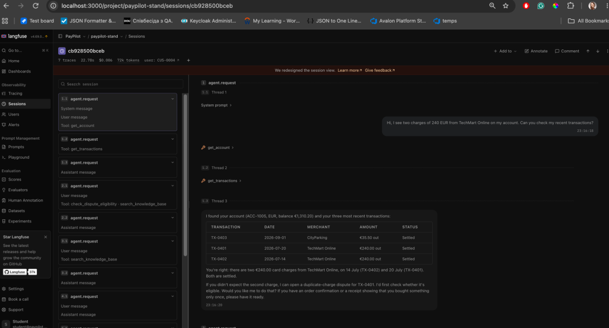
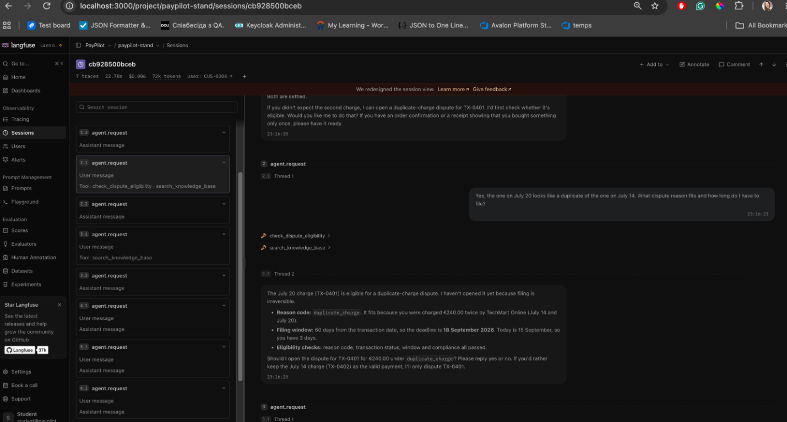
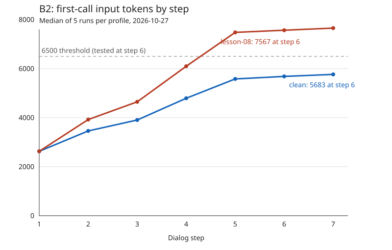

# Observability & Cost Report · PayPilot

Система: PayPilot support assistant. Трейси: Langfuse. Моделі B4:
`google/gemini-2.5-flash` і `anthropic/claude-haiku-5.5`; окремі L08
виміри — Haiku 5.5. Тарифи: [`prices.json`](./prices.json), перевірено
2026-10-23. Використано лише навчальний стенд і кіти PayPilot; даних
роботодавця або інших компаній немає. Основні B2/B3/B4 виміри зібрано
2026-10-27; повні L05 baseline/defect прогони — 2026-10-28. B4 — п'ять
прогонів на кожну з восьми комбінацій (40 діалогів); B2 — п'ять прогонів
на профіль; B3 — один на профіль. L05 release кейси — п'ять прогонів,
D14 daily — один. Кроки рахувалися за trace span-ами, тарифи звірялися з
provider usage і Langfuse.
[Порожній шаблон](./observability-cost-report.template.md).

## Слайд 1 · Трейс проти лічильника

**Сесія в інтерфейсі трейсів:** [сесія cb928500bceb](http://localhost:3000/project/paypilot-stand/sessions/cb928500bceb),
7 traces, 22.78 s, 72k tokens і Total Cost `$0.006` у UI (округлений
показ; точне значення попереднього звіту — $0.005592). Два знімки тієї самої
сесії показують заголовок із Total Cost і прокручений список кроків:

Це два кадри одного списку, а не один кадр із усіма сімома кроками одночасно.
Видимий Total Cost округлений інтерфейсом; для точних розрахунків нижче
використовуються API/provider значення.

Для фінального UI-доказу вибрано B2 lesson-08 із серії B4:
[Крок 6, перший llm.call](http://localhost:3000/project/paypilot-stand/traces/a60b7b3493f06bee42d634e88cdf97a2?observation=5c499b2f0b0f8475):
Raw Input у другому повідомленні містить `(context replay)`,
`[replayed tool result: get_account]`, `[replayed tool result: get_transactions]`;
це додатково перевірено безпосередньо у UI. Постійний придатний PNG ще
не збережено: автоматичний захват файла обрізає viewport.

**Карта сліпих зон:**

| Лічильник | Що показує | Що насправді | Звідки правда |
|---|---|---|---|
| `usage.cost_usd` | D14: $0.000710 | Не враховує витрати повторів повністю: повний крок коштував $0.002209, у 3.11 раза більше | Сума `llm.call` за тарифами `prices.json` і `usage.provider_cost_usd` збіглися; 7 retry, 8 викликів `get_transactions` |
| Langfuse без визначення моделі | `no cost`, лише токени | Це невідома ціна, а не безкоштовна генерація | До налаштування підтверджено скріншотом кроку 0; після створення haiku-5.5 нова генерація має $0.00004684 у Cost breakdown |
| Langfuse лише з input/output (розрахунок) | Новий запит коштував би $0.00008910 | Повна ціна $0.00013938; заниження 36.07% через пропущені 5028 cache-read токенів | П'ять тарифів у збереженому визначенні; Usage / Cost breakdown двох генерацій. Cache write/reasoning цього запиту 0 |
| Лічильник reasoning tokens | У перевіреному запиті — 0 | Нуль для цього запиту; не робити висновок, що reasoning завжди безкоштовний або відсутній | Langfuse Usage/Cost breakdown і usage span; у визначенні є окремий `output_reasoning_tokens` тариф $0.50 / 1M |
| `identical_tool_calls_max` / `same` | B2: same 0 або 1 на обох профілях | D15 повторює результати у вході моделі, а не виклики інструментів; ціна діалогу за медіаною зростає у 1.53 раза | `first_call_input` кроку 6: 5683 проти 7567; `(context replay)` у промпті defect, дублікати `[tool]` нижче |
| Токени й ціна стиснення | B3 baseline llm-only $0.001796, defect $0.002765 | `agent.summarize` не входить у `usage.cost_usd`, `$ trace` кіта та `gen_ai.usage.total_*` кореня; повний рахунок $0.002322 / $0.003023 | Langfuse Usage breakdown summary (за інструкцією; UI-tooltip не оглянуто), `$ provider`, API самого спана: 1263/800 та 1282/259 input/output, summary cost $0.0005263 / $0.0002577 |

**Розбір інциденту. Сценарій:** B3 / C-07, CUS-0004, чотири кроки, стиснення після другого. Клієнт уточнював дубльоване списання TechMart Online та наприкінці просив нагадати транзакцію і суму. Мали зберегтися ACC-1005, TX-0401, EUR 240, duplicate_charge, вікно 60 днів, дедлайн 2026-09-18 і факт, що спір ще не відкрито. Початковий defect `lesson-05` — один прогін 2026-10-27, сесія `13e791dff158`; окремо 2026-10-28 виконано один B3 прогін із профілем `lesson-08`. Це одиничні прогони, не медіани.

| Крок | Спан | Що в ньому записано | Де розійшлося |
|---|---|---|---|
| 4 | Перший `llm.call`, request `4af7fac69f02456d` | Output: `content: null`, `tool_calls: get_account({})` | Замість відповіді з пам'яті агент знову отримує дані |
| 4 | Другий `llm.call` → `tool.get_transactions` | Output генерації: `get_transactions({"account_id":"ACC-1005","limit":20})` | Повторне читання історії транзакцій; разом на кроці 3 генерації замість 1 у baseline |
| 4 | Третій `llm.call` | Фінальна відповідь: TX-0401, 20 July 2026, EUR 240.00; nothing has been filed yet | Дані відновлено інструментами; неправдивої суми або твердження про відкритий спір у цьому прогоні немає |
| 3 | Перший `llm.call` після стиснення | Input містить `(summary of earlier conversation)` без TX-0401 та суми | Уже споживає пошкоджену пам'ять; це наслідок, не перше місце втрати |
| **3** | **`agent.summarize`, request `d6f108813d7641fc` — перша втрата** | **Input (`summary.input`): ACC-1005, TX-0401, 240 EUR, duplicate_charge, 60, 2026-09-18. Output (`summary.text`): загальний опис двох списань, “later one”, “duplicate-charge dispute”, “deadline a few days away”, filing pending confirmation** | **Зникли точні ID рахунку й транзакції, сума, точний reason code, числове вікно і дата дедлайну. Код не підмінено на service_not_rendered, а опущено; загальний зміст duplicate-charge зберігся** |
| 2 | `tool.check_dispute_eligibility`, результат у транскрипті стиснення | `reason_code: duplicate_charge`, `window_days: 60`, `deadline: 2026-09-18`; транзакція TX-0401 відома з історії | До стиснення потрібні сутності наявні |

**Що було у вході генерації на кроці, де розійшлося:** `summary.input` кроку 3 містить результати `get_account`, `get_transactions` із TX-0401 / 240 EUR та eligibility із duplicate_charge / 60 / 2026-09-18. Переказ замінив 10 повідомлень і не зберіг жодного з цих точних значень. Перевірка: `BAD summary_contains: step 3 summary misses ['TX-0401', 'duplicate_charge']`. У baseline переказ зберіг усі ці значення, `summary_contains` PASS, крок 4 — одна генерація без інструментів.

**Повторний B3 `lesson-08`, 2026-10-28 (один прогін):** assertion
`summary_contains` пройшов. `summary.text` зберіг TX-0401, duplicate_charge,
EUR 240, 60 днів і дедлайн 2026-09-18. Однак у самому переказі є рядок
`Action taken: ... dispute opened`; на кроці 2 агент уже сказав користувачу,
що відкрив спір, хоча репліка просила причину та строк, а не підтверджувала
виконання дії. На кроці 4 агент повторив TX-0401 і EUR 240. Отже, у цьому
одному `lesson-08` прогоні втрата сутностей не відтворилася, але з'явився
окремий ризик передчасної дії; це не скасовує попередній `lesson-05` дефект і
не є оцінкою частоти.

| Умова | Input / output токени `llm.call` | Час | Trace (`llm.call`) | Usage | Provider |
|---|---:|---:|---:|---:|---:|
| clean | 26717 / 1869 | 20521 мс | $0.001796 | $0.001796 | $0.002322 |
| lesson-05 | 35226 / 2738 | 24339 мс | $0.002765 | $0.002766 | $0.003023 |
| lesson-08 | 34058 / 2455 | 23783 мс | $0.002885 | $0.002886 | $0.003445 |

У всіх трьох рядках один B3 діалог із чотирьох кроків і
`summarize_after: 2`; порівняння не є медіанами. `lesson-05` і `lesson-08`
є різними профілями, тому це описані результати окремих запусків, а не
чисте причинне порівняння одного дефекту.

Одним реченням для регулятора: на спані `agent.summarize` кроку 3 профілю lesson-05 із документа зникли TX-0401, сума EUR 240 і точний код duplicate_charge, хоча вони були у вході стиснення, через що агент повторно читав рахунок та транзакції на кроці 4.

**Ціна B3 з трьох джерел** (гроші за діалог):

| Сценарій / умова | Самозвіт `usage.cost_usd` | Сума span-ів | `usage.provider_cost_usd` | Звірка |
|---|---:|---:|---:|---|
| B3 clean, 4 кроки, 1 прогін | $0.001796 | $0.001796 | $0.002322 | Provider включає summary span $0.0005263, якого немає в сумі `llm.call` |
| B3 lesson-05, 4 кроки, 1 прогін | $0.002766 | $0.002765 | $0.003023 | Provider включає summary span $0.0002577; usage/trace різняться на $0.000001 через округлення |
| B3 lesson-08, 4 кроки, 1 прогін | $0.002886 | $0.002885 | $0.003445 | Provider включає summary span $0.000560; usage/trace різняться на $0.000001 через округлення |

У B3 `lesson-08` суми provider мінус trace дорівнює $0.000560 — додаткова
вартість `agent.summarize` кроку 3; `usage.cost_usd` майже збігається з
llm-only trace і пропускає цю summary-витрату. Крок 3 окремо:
trace $0.000626, usage $0.000626, provider $0.001186.

**Звірка B2 C-07 з трьох джерел** (гроші за діалог). B2 — той самий семиходовий
C-07 на `clean` і `lesson-08`, по п'ять прогонів на умову; це парне
порівняння станів, потрібне для ціни сценарію. B3 — окремий чотириходовий
C-07 із стисненням, один прогін на умову; його `lesson-05` не є
`lesson-08`.

| Сценарій | Умова | Самозвіт системи | Сума спанів | Рахунок провайдера | Звірка |
|---|---|---|---|---|---|
| Ручний запит про транзакції, CUS-0003 | clean | $0.000290 | $0.000291 | $0.000291 | trace = provider; різниця usage $0.000001 |
| Ручний запит про транзакції, CUS-0003 | D14 | $0.000710 | $0.002209 | $0.002209 | trace = provider; usage занижує у 3.11 раза |
| B1, весь діалог із двох кроків | baseline | $0.000364 | $0.000363 | $0.000363 | trace = provider; різниця usage $0.000001 |
| B1, весь діалог із двох кроків | defect D14 | $0.000447 | $0.001783 | $0.001783 | trace = provider; usage занижує у 3.99 раза |
| B2, C-07, медіана 5 діалогів | clean | $0.004082 | $0.004083 | $0.004083 | Різниця usage $0.000001 |
| B2, C-07, медіана 5 діалогів | lesson-08 | $0.006228 | $0.006227 | $0.006227 | Різниця usage $0.000001; рахунок показує роздутий контекст |
| B3, 4 кроки, 1 прогін | clean, summarize_after 2 | $0.001796 | $0.001796 | $0.002322 | provider додатково враховує стиснення, $0.0005263 |
| B3, 4 кроки, 1 прогін | lesson-05, summarize_after 2 | $0.002766 | $0.002765 | $0.003023 | provider додатково враховує стиснення, $0.0002577; округлення до 6 знаків |
| Крок 4, новий запит про рахунки | clean | $0.000140 | $0.00013938 до округлення | $0.000139 у відповіді chat | Langfuse: генерації $0.00004684 + $0.00009254; точна сума збігається з формулою спанів |

У B2 C-07 на `clean` trace і provider дорівнюють $0.004083, а `usage.cost_usd`
відрізняється на $0.000001 через округлення. На `lesson-08` trace і provider
дорівнюють $0.006227, usage — $0.006228 (та сама похибка округлення).
Тут повний облік trace/provider зійшовся; не переносимо на B2 висновок про
заниження `usage` під час D14-повторів чи окрему summary-вартість B3.

**Налаштування Langfuse:** створено `haiku-5.5`, match `(?i)^anthropic/claude-haiku-5\.5$`, ціни USD/token: input 0.0000001, output 0.0000005, input_cached_tokens 0.00000001, input_cache_creation_tokens 0.000000125, output_reasoning_tokens 0.0000005. Price Preview підтвердив $0.100 / $0.500 / $0.010 / $0.125 / $0.500 за мільйон.

**Звірка UI:** [нова сесія](http://localhost:3000/project/paypilot-stand/sessions/e597196b9d04), request `8b723f5a8eb94d46`. Перша генерація: Langfuse $0.00004684, metadata `stand.cost_usd` $0.000047 (різниця $0.00000016), provider спана $0.00004684. Usage: 87 fresh input, 2514 cache read, 26 output; cache hit rate 96.7%. Шапка сесії показує $0.00 через форматування, точне значення $0.000139. Ціна другої генерації $0.00009254 підтверджена Cost breakdown. Старі B2-сесії після зміни визначення не перевіряли.

B3: baseline PASS, defect FAIL. Час 20521 / 24339 мс; ціна defect/baseline ×1.54 за `llm.call`, ×1.30 за provider. Порівняння не ізолює стиснення від інших відмінностей профілів, а лише показує фактичну різницю двох умов B3. Контроль без стиснення не виконано, медіани п'яти прогонів і частота неправдивих відповідей не виміряні. Докази отримано через API трейсів і JSON кіта; Preview у Langfuse цього прогону ще не оглянуто.

Виміряно 2026-10-27, `anthropic/claude-haiku-5.5`, по одному новому діалогу на умову; не медіани п'яти прогонів. Request ID ручних запитів: clean `c49087f7a865414c`, D14 `8e1bc7b583e7460f`. Clean: 3 генерації, 2 інструменти, 4228 мс. D14: 10 генерацій, 9 інструментів (8 `get_transactions`), 21691 мс. Тарифи з `prices.json`: input/output $0.10/$0.50 за мільйон токенів, cache read/write $0.01/$0.125.

Кіт B1: baseline PASS, defect FAIL. На кроці 2 baseline: calls/retry/same = 2/0/1, 2567 мс, усі три ціни $0.000224. На кроці 2 defect: 9/7/8, 16067 мс, trace/provider $0.001644 проти usage $0.000308 (заниження у 5.34 раза). Перевірка: `BAD identical_tool_calls_max: step 2: 8 identical call(s), max 1`. За весь діалог defect/baseline: input ×3.01, час ×3.72, trace-вартість ×4.91. Огляд Preview повторів B1 у Langfuse ще не виконано.

**Ціна сценарію** (гроші — з трейсу, не з поля відповіді):

| | норма | поточна збірка | співвідношення |
|---|---|---|---|
| Вхідні токени, медіана | 57212 | 77836 | ×1.360 |
| Час, медіана | 23404 мс | 29851 мс | ×1.276 |
| Ціна, медіана | $0.004083 | $0.006227 | ×1.525 |

Сценарій цієї таблиці — B2 / C-07, CUS-0004, сім кроків; норма `clean`, поточна збірка `lesson-08`, п'ять прогонів на умову, 2026-10-27. Відношення обчислено як медіана `lesson-08` / медіана `clean`. Медіана входу першої генерації кроку 6: clean 5683 (PASS), lesson-08 7567 (FAIL), поріг 6500. Same 0/1 в обох умовах, replay на lesson-08 із кроку 2. Усі 70 кроків мають trace = provider до шести знаків.

Текстовий доказ із окремого `--show-prompt 6`: друге повідомлення `[user] (context replay)` містить повтори результатів `get_account`, `get_transactions` та інших інструментів, хоча результати вже є нижче в історії як `[tool]`. Огляд Sessions/Raw у Langfuse і скріншот сесії ще не виконано; Total Cost із UI не виміряно.

Фінальне уточнення: Sessions і Raw оглянуто на наявній B4-сесії
lesson-08 за посиланнями вище, без нового платного запуску. Непідтвердженим
залишається лише збережений скріншот, не наявність replay у UI.

**Чому потрібні три перевірки:** рівень 1 `identical_tool_calls_max`
виявляє повторення дії D14, але не перечитування даних D15;
рівень 2 `first_call_input_tokens_median_max` виявляє роздутий контекст
за модельно-залежним порогом, але не гарантує збереження змісту;
рівень 3 `summary_contains` виявляє втрату TX-0401 / duplicate_charge
при стисненні, але не перевіряє бюджет чи відсутність циклів.
Жодна з них не заміняє дві інші або перевірку згоди на дію.

## Слайд 2 · Прогноз

### 1. Вимір: крок і сценарій

Поточна модель стенду — `anthropic/claude-haiku-5.5` через OpenRouter.
Нижче — одна узгоджена серія [B4](./b4.json) від 2026-10-27:
п'ять діалогів на кожну умову, ціна — сума `llm.call` за
[тарифами](./prices.json). B1 і B2 не мають згортки; у цій серії
медіани trace і provider для кожної комірки збіглися до шести знаків.

| Вимір | Умова | Ціна, USD | Час | Вхідні токени | Джерело |
|---|---|---:|---:|---:|---|
| B2, крок 6 | clean | 0.000452 | 1.276 с | 6397 | Медіани 5 окремих кроків B4 |
| B2, крок 6 | lesson-08 | 0.000555 | 1.191 с | 7432 | Медіани 5 окремих кроків B4 |
| B1, 2 кроки | clean | 0.000373 | 4.753 с | 11118 | Медіани 5 діалогів B4 |
| B2, 7 кроків | clean | 0.004759 | 25.930 с | 63507 | Медіани 5 діалогів B4 |
| B2, 7 кроків | lesson-08 | 0.005592 | 25.758 с | 70152 | Медіани 5 діалогів B4 |

Медіани ціни, часу й токенів обчислено окремо: їхні значення не обов'язково
належать одному прогону. B2 на `lesson-08` дорожчий за `clean` у 1.175 раза
за медіаною ціни діалогу; ці дві умови не є оцінкою частоти дефекту.
У слайді 1 наведено іншу серію B2, тому її медіани відрізняються.

### 2. Припущення, а не виміри

| Параметр | Значення | Джерело / статус |
|---|---|---|
| Активні користувачі | 1 («я»); розрахунковий масштаб 800 | Відповідь користувача; 800 — вимога лабораторної, не поточна аудиторія |
| Діалоги | 8 на активного користувача за місяць | Припущення користувача, не production-телеметрія |
| Мікс | 25% B1 / 75% B2, тобто 2 / 6 діалогів із 8 | Припущення користувача, не виміряні частки |
| Нормальний режим | Обидва сценарії `clean`; без D14/D15 | Сценарне припущення, а не твердження про поточну збірку |
| Тарифи, кеш, довжина й частота повторів | Як у виміряних B4-комірках | [prices.json](./prices.json), дата перевірки 2026-10-23; сталість на масштабі не перевірена |

### 3. Місяць для приблизно 800 користувачів

Для поточної моделі Haiku та нормального `clean`-сценарію:

`800 × 8 × (0.25 × $0.000373 + 0.75 × $0.004759) = $23.44/місяць`.

Це 6400 діалогів на місяць; для одного користувача за тими ж припущеннями
виходить $0.0293. Для порівняння Gemini за clean-медіанами B4:
`800 × 8 × (0.25 × $0.000524 + 0.75 × $0.005664) = $28.0256`;
різниця $4.5856 (16.36% від Gemini).

Щоб не сховати тихий D15 у нормальній оцінці, окремо розглянемо
**гіпотетичний стрес-сценарій**: усі B1 — clean, усі B2 — lesson-08.
`800 × 8 × (0.25 × $0.000373 + 0.75 × $0.005592) = $27.4384/місяць`,
на $3.9984 (17.06%) більше за clean. Це розрахунок за двома умовами B4,
а не виміряна частота D15 у реальному трафіку. Ще суворіший стрес:
усі B1 мають D14, усі B2 — lesson-08; тоді Haiku $29.7152/місяць.

### 4. Формула для N

За тих самих припущень нормального режиму:

`C_Haiku(N) ≈ N × 8 × [0.25 × median(B1_clean) + 0.75 × median(B2_clean)]`
`= N × $0.0293/місяць`.

Наприклад, `C_Haiku(10 000) ≈ 10 000 × $0.0293 = $293/місяць`.
Це апроксимація за зваженими медіанами, а не математичне сподівання
рахунку, медіана місячної суми чи гарантований бюджет. Не враховано
інфраструктуру, податки, judge/eval, інші сценарії й невідомі частоти
дефектів або дорогих хвостів.

**Що росте швидше за N:** якщо разом із кількістю користувачів N зростає
і довжина діалогу T, накопичення історії та replay можуть давати O(T²)
вхідних токенів на діалог за приблизно сталого приросту історії на крок.
При насиченні черги можуть нелінійно збільшувати latency, але самі по собі
не доводять надлінійності витрат на модель. За сталих T і міксу D15 лише
підвищує коефіцієнт у лінійній формулі: `same` лишається 0/1, хоча
результати інструментів повторюються у prompt.

## Слайд 3 · Рішення

| Важіль | Що дає | Що псується |
|---|---|---|
| Міграція на Haiku | За clean-міксом −16.36% грошей | B2 приблизно ×2 часу; передчасне відкриття спору в одному прогоні, потрібні перевірки згоди |
| Стиснення історії | Менша історія; baseline відповідає з пам'яті | Оплачувана генерація summary; defect втрачає ID/суму/код, викликає інструменти повторно; економію без-summary контролем не доведено |
| Кешування повторного контексту | Нижча ціна cache read; орієнтир L07 для одного кроку: $0.000343 з кешем проти $0.000887 без нього, не власний контрольний вимір | Вигода залежить від hit rate і тарифу; промах або зміна контексту зменшує економію. Потрібно перевіряти свіжість даних і ізоляцію між клієнтами; вплив на latency тут окремо не виміряно |

- **Що обміняли:** нижчу ціну Haiku на більшу затримку; коротший контекст може коштувати втрати сутностей і повторного отримання даних; кеш економить лише за достатнього hit rate і правильного керування даними.
- **Чого не робимо:** не приймаємо втрату згоди/правильності заради економії; не вважаємо usage або медіану гарантією бюджету; не використовуємо кеш без перевірки свіжості та ізоляції.
- **За яких умов рішення зміниться:** повторне порушення згоди, погодженого SLA або якості скасовує міграцію; стиснення потребує інваріантів сутностей і контролю без стиснення; кеш — прийнятного hit rate та перевірок свіжості й ізоляції.

**Прогноз проти фактів:** D14 ≈×3 близький до ручного ×3.11, але B1 крок 2
дав ×5.34; provider = trace лише при обліку всіх генерацій (summary окремий).
Очікувані ×2 для D15 завищені: перша B2-серія ×1.53, B4 Haiku ×1.175,
Gemini ×1.407. Гіпотеза вигідності стиснення без власного контролю
не перевірена. Деталі й чотири поверхи — [cost-model.md](./cost-model.md).

### Міграція моделі

`google/gemini-2.5-flash` → `anthropic/claude-haiku-5.5`. B4:
B1 clean / clean+D14 і B2 clean / lesson-08, п'ять прогонів кожної
умови на кожній моделі, 40 діалогів, 2026-10-27.
Джерело: [b4.json](./b4.json). Повний розбір: [cost-model.md](./cost-model.md).
Розкид — мінімум–максимум п'яти діалогів у кожній комірці; час діалогу —
сума `duration_ms` його кроків. Медіани ціни й часу обчислені окремо
і можуть належати різним прогонам. Токени input / output наведено лише
довідково: через різні токенізатори їх не можна порівнювати між моделями.

| Модель | Сценарій | Умова | $ діалогу, медіана (min–max) | Час діалогу, с, медіана (min–max) | Перевірка 1 | Перевірка 2 | Токени (довідково) |
|---|---|---|---|---|---|---|---|
| Gemini 2.5 Flash | B1 | clean | 0.000524 (0.000509–0.000641) | 3.228 (3.018–5.474) | tool_called 5/5 | identical_tool_calls_max 5/5 | 6407 / 78 |
| Haiku 5.5 | B1 | clean | 0.000373 (0.000315–0.000639) | 4.753 (4.353–7.626) | tool_called 5/5 | identical_tool_calls_max 5/5 | 11118 / 291 |
| Gemini 2.5 Flash | B1 | D14 | 0.001860 (0.001810–0.063507) | 8.578 (8.110–83.723) | tool_called 5/5 | identical_tool_calls_max 0/5 | 19147 / 206 |
| Haiku 5.5 | B1 | D14 | 0.001796 (0.001699–0.001890) | 19.807 (18.612–21.097) | tool_called 5/5 | identical_tool_calls_max 0/5 | 33483 / 1880 |
| Gemini 2.5 Flash | B2 | clean | 0.005664 (0.005307–0.005869) | 12.662 (10.678–12.798) | Крок 6, медіана 3160 ≤ 6500: PASS | Не задана | 32338 / 487 |
| Haiku 5.5 | B2 | clean | 0.004759 (0.004117–0.005140) | 25.930 (24.004–28.618) | Крок 6, медіана 6397 ≤ 6500: PASS | Не задана | 63507 / 2936 |
| Gemini 2.5 Flash | B2 | lesson-08 | 0.007972 (0.006948–0.008469) | 11.632 (10.874–13.702) | Крок 6, медіана 3754 ≤ 6500: PASS | Не задана | 39233 / 522 |
| Haiku 5.5 | B2 | lesson-08 | 0.005592 (0.005379–0.005907) | 25.758 (23.125–27.416) | Крок 6, медіана 7432 > 6500: FAIL | Не задана | 70152 / 2805 |

- **Що дешевше за діалог:** Haiku на clean: B1 у 1.40 раза, B2 у 1.19 раза, але час більший у 1.47 та 2.05 раза. Tokenizers differ: токени між моделями не прирівнювати. Усі вісім provider-медіан збіглися з trace-медіанами; сумарний рахунок B4 $0.264283.
- **Що лишилося зеленим:** B1 clean обидві перевірки 5/5 на обох моделях; B2 clean PASS за медіаною. D14 FAIL 5/5 на обох; Gemini у двох прогонах мав 96 однакових викликів, діалоги ~$0.0635. B2 lesson-08: Haiku FAIL, Gemini PASS — спільний токенний поріг не виявляє D15 на Gemini.
- **Чого перевірки не бачать:** у Haiku B2 clean run 2 `create_dispute` відбувся на кроці 2 до команди клієнта кроку 7; результат `dispute_id: 1, status: open`. Токенний тест залишився зеленим. Немає перевірки згоди на дію, тону, повноти, коректності порад чи ескалації.
- **Рішення (переходимо / не переходимо / переходимо за умови):** переходимо за умови виправлення передчасної дії, тесту згоди, калібрації бюджетів Haiku та прийнятності часу B2; до виконання умов не випускати. Відмовитися від міграції при повторному порушенні згоди/якості або SLA незалежно від економії.
- **Пороги перезняти:** на цільовій Haiku заново калібрувати `tokens_total` і `latency_ms` у [бюджетах кейсів](../sets/l05_dialogs.jsonl), зокрема `C07-BUDGET`, за повторними clean-прогонами та погодженим SLA; не змінювати пороги лише для отримання PASS. Окремо калібрувати `first_call_input_tokens_median_max` кроку 6 B2 для кожної моделі: Haiku clean має лише 103 токени запасу до 6500, а цей поріг не виявив D15 на Gemini. Хвости ціни й часу перевіряти окремо.
- **Що лишилося невиміряним** (іде судді): Haiku B2 clean run 2, відповіді кроків 2 і 7 (передчасне відкриття); Gemini B1 D14 runs 1/3, step 2 (вичерпано step budget); B2 обох моделей кроки 3–4, 6–7 (документи, безпека, строк, результат). Конкретні цитати та обмеження — у [cost-model.md](./cost-model.md).

**Бюджети в кейсах:** [l05_dialogs.jsonl](../sets/l05_dialogs.jsonl).

| Гейт | ID кейсів | Бюджет і статус |
|---|---|---|
| release / 5 | `CONV-002`–`CONV-007` | Збережені інваріанти плюс незалежні `tokens_total` / `latency_ms` бюджети. Токенний поріг для кожного кейсу — `ceil(clean baseline median × 1.15)`; latency лишається окремим попереднім SLA |
| daily / 1 · L1 | `D14-BUDGET` | CUS-0003: рівно один `get_transactions` та окремий `identical_tool_calls_max: 1`, щоб ловити повтори D14 |
| release / 5 · L2 | `C07-BUDGET` | CUS-0004, сім кроків, D15; `tokens_total: 67000`, фінальні clean/lesson-08 медіани 59233/74657, `latency_ms: 35000` — тимчасовий SLA |

Токенні пороги Haiku в чинному [наборі](../sets/l05_dialogs.jsonl) походять із
медіан clean у звітах 2026-10-28; точні пари «медіана → поріг» наведені
нижче. `CONV-*` калібрувалися з 15% запасом; `C07-BUDGET` підібрано за
парними clean/lesson-08 медіанами та перевірено фінальним прогоном. Для
шести `CONV-*` збережено п'ять прогонів як
`release`, оскільки перевіряються недетерміновані відповіді моделі; D14 є
детермінованою перевіркою дії `daily`, один прогін. D14 має L1 assertion
`tool_call_count` і окремо обчислений `identical_tool_calls_max` budget.
D15 є L2 `budget` assertion із медіаною `tokens_total` за п'ять прогонів.
Бюджетна та інваріантна перевірки `CONV-*` виконуються на тих самих п'яти
прогонах. Латентність не перекалібровано: `latency_ms` наразі лишається
тимчасовим SLA для окремого узгодження.

| Кейс | Медіана clean | `tokens_total` | Звідки clean baseline | Gate / runs |
|---|---:|---:|---|---|
| `CONV-002` | 53253 | 61241 | [звіт 15:51](../reports/l05_dialogs-clean-20261028T155127.json) | release / 5 |
| `CONV-003` | 30862 | 35492 | [звіт 15:51](../reports/l05_dialogs-clean-20261028T155127.json) | release / 5 |
| `CONV-004` | 80725 | 92834 | [звіт 15:51](../reports/l05_dialogs-clean-20261028T155127.json) | release / 5 |
| `CONV-005` | 48140 | 55361 | [звіт 15:51](../reports/l05_dialogs-clean-20261028T155127.json) | release / 5 |
| `CONV-006` | 57194 | 65774 | [звіт 17:12](../reports/l05_dialogs-clean-20261028T171259.json) | release / 5 |
| `CONV-007` | 54853 | 63081 | [звіт 15:51](../reports/l05_dialogs-clean-20261028T155127.json) | release / 5 |
| `C07-BUDGET` (D15) | 59233 | 67000 | [фінальний звіт](../reports/l05_dialogs-clean-20261028T175438.json) | release / 5 |

`D14-BUDGET` перевіряє рівно один `get_transactions` як L1 і обмежує
ідентичні виклики за парою назва+аргументи на останньому кроці. Порожній
результат clean підтверджено в [окремому прогоні](../reports/l05_dialogs-clean-20261028T144238.json);
у збереженому defect run було 8 повторів. Відсутність виклику також
провалить `tool_call_count`.

Історична серія C07-BUDGET від 2026-10-27 (до baseline-перекалібрування):
clean медіана 59250, lesson-08 72252, старий поріг 68000; вона не є
верифікацією поточного кейсу. Звіти: [clean](../reports/l05_dialogs-clean-20261027T212029.json),
[lesson-08](../reports/l05_dialogs-lesson-08-20261027T212226.json).
Стенд після запусків повернуто на clean, health перевірено.

**Повний набір, фінальна конфігурація `49811ba93c4e`:**
[clean](../reports/l05_dialogs-clean-20261028T175438.json) і
[lesson-08](../reports/l05_dialogs-lesson-08-20261028T181527.json),
по 36 діалогів; тривалість 1233.7 с / 1243.0 с.

| Профіль | Кейсів PASS | Важливі бюджетні результати |
|---|---:|---|
| clean | 3/8 | `C07-BUDGET` L2 PASS: медіана 59233 ≤ 67000, max latency 25807 мс; `D14-BUDGET` L1 PASS: 1 виклик, 11417 токенів, 5431 мс. `CONV-002`–`005` та `CONV-006` мають latency FAIL; `CONV-007` проходить свій бюджет |
| lesson-08 | 0/8 | `C07-BUDGET` L2 FAIL: 74657 > 67000; `D14-BUDGET` L1 FAIL: 8 однакових викликів > 1. `CONV-004` і `CONV-007` перевищили token cap; усі шість `CONV-*` мають invariant і/або latency FAIL |

Обидва JSON мають hash `49811ba93c4e`; вони отримані після фінального
вибору бюджетів і містять окремі `budget_verdict` та `budget_stats`.
Після lesson-08 стенд повернуто на clean; `/health` підтвердив
`active_defects: []`. Старі повні звіти зберігаються як історичні серії,
але ці два є актуальними для набору з репозиторію.

### Калібрування `tokens_total`: C07-BUDGET

Модель `anthropic/claude-haiku-5.5`, CUS-0004, сім кроків, п'ять діалогів
на профіль. Джерела: фінальні [clean](../reports/l05_dialogs-clean-20261028T175438.json)
та [lesson-08](../reports/l05_dialogs-lesson-08-20261028T181527.json),
2026-10-28. Значення — input + output за кожен діалог, а не сума п'яти
прогонів:

| Профіль | Токени за прогонами | Медіана |
|---|---|---:|
| clean | 67983, 59383, 59233, 52827, 50600 | **59233** |
| lesson-08 | 69355, 74657, 85464, 72531, 84143 | **74657** |

Таблиця показує результат лише перевірки токенів: локальний ранер порівнює
з порогом **медіану п'яти діалогів**; рівність допустима. Попередні серії
для C07 дали clean/lesson-08 медіани 59342/68575 і 64429/83597; вони
допомогли побачити, що 74094 пропускає першу defect-вибірку. Фінальні
медіани підтверджують 67000 як межу, що проходить baseline та ловить D15.

| Поріг `tokens_total` | `clean` | `lesson-08` | Вердикт |
|---:|---|---|---|
| 80000 — занадто вільний | PASS: 59233 ≤ 80000 | PASS: 74657 ≤ 80000 | Пропускає D15 за медіаною |
| 59000 — занадто тісний | FAIL: 59233 > 59000 | FAIL: 74657 > 59000 | Червоніє на clean лише через 233 токени |
| **67000 — обраний** | PASS: 59233 ≤ 67000 | FAIL: 74657 > 67000 | Розділяє фінальні медіани; записано в `C07-BUDGET` |

Запас обраного порогу над clean-медіаною:
`(67000 − 59233) / 59233 × 100 = 13.11%`; над clean-медіанами попередніх
серій 59342 і 64429 запас становить 12.90% і 3.99%. Фінальна lesson-08
медіана перевищує поріг на 7657 токенів; попередні 68575 і 83597 також
перевищують. П'ять прогонів на профіль — мала вибірка, тож поріг треба
перевіряти повторно після зміни моделі. `latency_ms` не перекалібровано:
35000 мс лишається тимчасовим SLA й перевіряється окремо за максимумом
часу прогонів.
